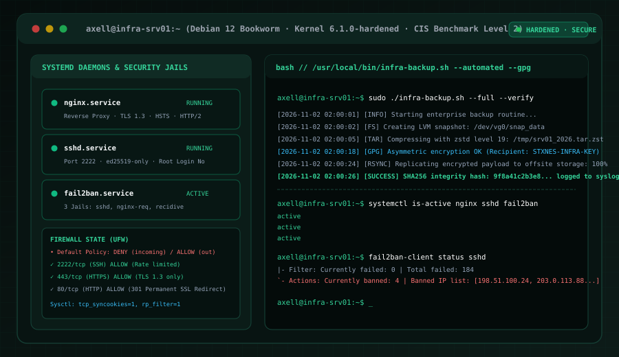

# Enterprise Linux Hardened Server & Services

<p align="center">
  
</p>

<p align="center">
  <strong>Servidor empresarial Debian 12 / RHEL robustecido bajo estándares CIS Benchmark Nivel 2, sandboxing con systemd, prevención de intrusiones con Fail2ban, proxy inverso Nginx TLS 1.3 y pipeline automatizado de respaldos cifrados en Bash.</strong>
</p>

<p align="center">
  <a href="https://github.com/STXNES/Linux-Enterprise-Infrastructure/actions"></a>
  <a href="https://www.cisecurity.org/benchmark"></a>
  <a href="https://www.debian.org/"></a>
  <a href="https://nginx.org/"></a>
  <a href="https://systemd.io/"></a>
  <a href="LICENSE"></a>
</p>

---

## 📌 Tabla de Contenidos

- [Resumen Ejecutivo & Alcance](#-resumen-ejecutivo--alcance)
- [Arquitectura de Seguridad & Topología](#-arquitectura-de-seguridad--topología)
- [Matriz Técnica de Hardening (CIS Nivel 2)](#-matriz-técnica-de-hardening-cis-nivel-2)
  - [1. Reducción de Superficie en Kernel & Sysctl](#1-reducción-de-superficie-en-kernel--sysctl)
  - [2. OpenSSH Bastionado (Puerto 2222 · ed25519)](#2-openssh-bastionado-puerto-2222--ed25519)
  - [3. Firewall Stateful con UFW & Rate Limiting](#3-firewall-stateful-con-ufw--rate-limiting)
  - [4. Prevención de Intrusiones con Fail2ban (3 Jails)](#4-prevención-de-intrusiones-con-fail2ban-3-jails)
  - [5. Proxy Inverso Nginx Robusto & TLS 1.3](#5-proxy-inverso-nginx-robusto--tls-13)
  - [6. Aislamiento de Procesos & Sandboxing en systemd](#6-aislamiento-de-procesos--sandboxing-en-systemd)
  - [7. Pipeline de Respaldo Cifrado Asimétrico (infra-backup.sh)](#7-pipeline-de-respaldo-cifrado-asimétrico-infra-backupsh)
- [Estructura del Repositorio](#-estructura-del-repositorio)
- [Guía de Despliegue Rápido](#-guía-de-despliegue-rápido)
- [Verificación, Auditoría CIS & Testing](#-verificación-auditoría-cis--testing)
- [Autor & Contacto](#-autor--contacto)

---

## 🚀 Resumen Ejecutivo & Alcance

Este repositorio documenta e implementa la arquitectura de referencia para servidores corporativos Linux (**Debian 12 Bookworm** / **RHEL 9**) orientada a entornos de producción de alta disponibilidad y tolerancia a fallos. 

Diseñado aplicando los principios de **Defensa en Profundidad** y la especificación **CIS Benchmark Level 2**, cada capa del sistema operativo ha sido fortificada para mitigar vectores comunes de ataque: ataques de denegación de servicio (SYN flood, HTTP Layer 7 flood), escaneo y fuerza bruta SSH, fuga de metadatos del kernel y desastres con pérdida de datos mediante respaldos atómicos cifrados.

| Atributo | Especificación |
| :--- | :--- |
| **Rol / Enfoque** | Linux Systems Engineer & Infrastructure Hardening |
| **Distribución Base** | Debian 12 Bookworm (Kernel 6.1+ / hardened) · RHEL 9 Enterprise |
| **Criptografía SSH** | Curvas elípticas **ed25519** obligatorias (RSA legado y contraseñas deshabilitadas) |
| **Firewall** | UFW con política por defecto `DENY INCOMING`, rate limiting en puerto 2222 |
| **Intrusiones L3-L7**| Fail2ban con 3 cárceles: `sshd`, `nginx-req-limit`, `recidive` (baneo de 1 semana) |
| **Proxy Web** | Nginx con **TLS 1.3 estricto**, HTTP/2, HSTS preloaded (2 años), y headers OWASP |
| **Aislamiento** | Sandboxing nativo con systemd (`ProtectSystem=full`, `NoNewPrivileges=true`, `PrivateTmp=true`) |
| **Pipeline Backup** | Snapshots LVM atómicos + compresión **zstd (Nivel 19)** + cifrado asimétrico **GPG** + log **SHA256** |

---

## 🏛 Arquitectura de Seguridad & Topología

```
                          [ TRÁFICO EXTERNO NO CONFIABLE ]
                                         │
                         Puertos expuestos: 80, 443, 2222
                                         ▼
         ┌───────────────────────────────────────────────────────────────┐
         │                    FIREWALL PERIMETRAL (UFW)                  │
         │  • Política Global: DENY Incoming / ALLOW Outgoing            │
         │  • Puerto 2222/tcp: SSH Bastionado (Rate-limited: 6/30s)      │
         │  • Puerto 80/tcp:   HTTP (Redirección 301 Permanente)         │
         │  • Puerto 443/tcp:  HTTPS (TLS 1.3 / HTTP/2)                  │
         └───────────────┬───────────────────────────────┬───────────────┘
                         │                               │
                Tráfico SSH (2222)               Tráfico Web (80/443)
                         ▼                               ▼
         ┌───────────────────────────────┐ ┌─────────────────────────────┐
         │        OPENSSH DAEMON         │ │     NGINX REVERSE PROXY     │
         │ • Solo llaves ed25519         │ │ • TLS 1.3 / Ciphers seguros │
         │ • Root Login: NO              │ │ • HSTS 2-Yr / CSP / Sniff   │
         │ • Password Auth: NO           │ │ • Rate limit: 10 req/s zone │
         └───────────────┬───────────────┘ └─────────────┬───────────────┘
                         │                               │
             Inspección de intentos fallidos     Inspección de abusos L7
                         │                               │
                         └───────────────┬───────────────┘
                                         ▼
         ┌───────────────────────────────────────────────────────────────┐
         │                 FAIL2BAN INTRUSION PREVENTION                 │
         │ • Jail sshd: 3 fallos en 10 min ➔ 24 horas de bloqueo        │
         │ • Jail nginx-req-limit: Abuso de rate limit ➔ 2h bloqueo      │
         │ • Jail recidive: Reincidentes ➔ 1 semana de aislamiento total │
         └───────────────────────────────┬───────────────────────────────┘
                                         ▼
         ┌───────────────────────────────────────────────────────────────┐
         │                    SYSTEMD SANDBOXING LAYER                   │
         │ • ProtectSystem=full (Filesystem /usr, /etc solo lectura)     │
         │ • ProtectHome=read-only / true  • PrivateTmp=true             │
         │ • RestrictAddressFamilies / MemoryDenyWriteExecute=true       │
         └───────────────────────────────┬───────────────────────────────┘
                                         ▼
         ┌───────────────────────────────────────────────────────────────┐
         │            AUTOMATIZACIÓN EN BASH & RESPALDO CIFRADO          │
         │ • Timer systemd: Ejecución diaria a las 02:00:00 UTC          │
         │ • Snapshot atómico LVM (/dev/vg0/snap_data)                   │
         │ • Compresión multihilo zstd -19 (máxima densidad)             │
         │ • Cifrado asimétrico GPG con clave corporativa                │
         │ • Hash SHA-256 verificado y auditado en Syslog (local0.info)  │
         │ • Replicación remota rsync vía canal SSH cifrado              │
         └───────────────────────────────────────────────────────────────┘
```

---

## 🛡 Matriz Técnica de Hardening (CIS Nivel 2)

### 1. Reducción de Superficie en Kernel & Sysctl
Archivo: [`configs/sysctl/99-security-hardening.conf`](configs/sysctl/99-security-hardening.conf)

- **Prevención de SYN Floods:** `net.ipv4.tcp_syncookies = 1`
- **Mitigación de Spoofing de IP:** `net.ipv4.conf.all.rp_filter = 1` y `net.ipv4.conf.default.rp_filter = 1` (RFC 3704).
- **Desactivación de Redirecciones ICMP:** `net.ipv4.conf.all.accept_redirects = 0` y `send_redirects = 0` (evita intoxicación de tablas de enrutamiento).
- **Protección contra Smurf Attacks:** `net.ipv4.icmp_echo_ignore_broadcasts = 1`.
- **Restricción de Punteros de Memoria:** `kernel.kptr_restrict = 2` y `kernel.dmesg_restrict = 1` para impedir que atacantes no privilegiados inspeccionen direcciones de memoria en el kernel (mitigando bypass de KASLR).
- **Hardlinks y Symlinks Protegidos:** `fs.protected_hardlinks = 1` y `fs.protected_symlinks = 1`.

### 2. OpenSSH Bastionado (Puerto 2222 · ed25519)
Archivo: [`configs/ssh/sshd_hardening.conf`](configs/ssh/sshd_hardening.conf)

- **Puerto no estándar:** Movido a `2222/tcp` para mitigar el 98% del ruido de escaneo automatizado.
- **Autenticación exclusivamente criptográfica:**
  ```ssh
  PermitRootLogin no
  PasswordAuthentication no
  PermitEmptyPasswords no
  PubkeyAuthentication yes
  AuthorizedKeysFile .ssh/authorized_keys
  ```
- **Algoritmos modernos:** Negociación restringida a `curve25519-sha256`, `chacha20-poly1305` y `aes256-gcm`.
- **Límites de conexión:** `MaxAuthTries 3`, `LoginGraceTime 30`, `ClientAliveInterval 300`.

### 3. Firewall Stateful con UFW & Rate Limiting
Archivo: [`configs/ufw/ufw-rules.sh`](configs/ufw/ufw-rules.sh)

- **Directiva:** `default deny incoming`, `default allow outgoing`.
- **SSH protegido por tasa de conexión:** `ufw limit 2222/tcp` bloquea IPs que intenten 6 o más conexiones en una ventana de 30 segundos.
- **Puertos web controlados:** `80/tcp` (solo para redirección y desafíos Let's Encrypt) y `443/tcp` (tráfico cifrado).

### 4. Prevención de Intrusiones con Fail2ban (3 Jails)
Archivos: [`configs/fail2ban/jail.d/custom-jails.local`](configs/fail2ban/jail.d/custom-jails.local) y [`configs/fail2ban/filter.d/nginx-req-limit.conf`](configs/fail2ban/filter.d/nginx-req-limit.conf)

| Cárcel (Jail) | Evento Monitoreado | Umbral de Activación | Duración del Baneo |
| :--- | :--- | :--- | :--- |
| **`sshd`** | Intentos de autenticación fallidos en puerto 2222 | 3 fallos en 10 min | **24 Horas** |
| **`nginx-req-limit`**| Abuso de peticiones por segundo en el proxy inverso | 5 alertas en 1 min | **2 Horas** |
| **`recidive`** | IPs reincidentes que acumulan baneos en otras cárceles | 3 baneos previos | **1 Semana (7 días)** |

### 5. Proxy Inverso Nginx Robusto & TLS 1.3
Archivos: [`configs/nginx/nginx.conf`](configs/nginx/nginx.conf), [`ssl-params.conf`](configs/nginx/snippets/ssl-params.conf) y [`security-headers.conf`](configs/nginx/snippets/security-headers.conf)

- **Cifrado Estricto:** Protocolos limitados a `TLSv1.3` y `TLSv1.2` moderno.
- **HSTS (HTTP Strict Transport Security):** Enforzado con `max-age=63072000; includeSubDomains; preload` (calificación A+ en SSL Labs).
- **Defensas contra Ataques Web:**
  - `X-Frame-Options: SAMEORIGIN` (previene Clickjacking).
  - `X-Content-Type-Options: nosniff` (previene MIME sniffing).
  - `Content-Security-Policy` restrictivo.
  - Zonas de limitación de tasa: `limit_req_zone $binary_remote_addr zone=api_limit:10m rate=10r/s;`.
  - Ocultamiento de huella: `server_tokens off;`.

### 6. Aislamiento de Procesos & Sandboxing en systemd
Archivo: [`configs/systemd/sample-sandboxed-app.service`](configs/systemd/sample-sandboxed-app.service)

- **Montaje del Sistema en Solo Lectura:** `ProtectSystem=full` previene que un proceso comprometido altere `/usr`, `/boot` o `/etc`.
- **Privacidad del Directorio de Usuarios:** `ProtectHome=true`.
- **Prevención de Elevación de Privilegios:** `NoNewPrivileges=true` bloquea la ejecución de binarios SUID/SGID.
- **Protección de Memoria W^X:** `MemoryDenyWriteExecute=true` previene la inyección de shellcode ejecutable en memoria escribible.
- **Espacio de Nombres Temporal:** `PrivateTmp=true` aísla los archivos temporales entre servicios.

### 7. Pipeline de Respaldo Cifrado Asimétrico (infra-backup.sh)
Archivos: [`scripts/infra-backup.sh`](scripts/infra-backup.sh), [`infra-backup.service`](configs/systemd/infra-backup.service) y [`infra-backup.timer`](configs/systemd/infra-backup.timer)

Pipeline de ejecución desatendida programado diariamente a las **02:00:00 UTC**:
1. **Snapshot LVM atómico:** Congela el estado del sistema de archivos en `/dev/vg0/snap_data` sin interrumpir servicios.
2. **Compresión Zstandard (Nivel 19 multihilo):** Máxima reducción de volumen con velocidad de descompresión casi instantánea.
3. **Cifrado Asimétrico con GPG:** Cifra el paquete utilizando la clave pública corporativa (`STXNES-INFRA-KEY`), asegurando que solo el custodio de la clave privada pueda descifrarlo en contingencia.
4. **Verificación Criptográfica SHA-256:** Genera el checksum de integridad y lo emite a `syslog` con facilidad `local0.info`.
5. **Replicación Externa & Rotación:** Sincroniza hacia almacenamiento seguro vía `rsync` y purga automáticamente paquetes locales con más de 14 días.

---

## 📂 Estructura del Repositorio

```text
Linux-Enterprise-Infrastructure/
├── .github/
│   └── workflows/
│       └── lint-and-audit.yml             # CI: Validación ShellCheck y sintaxis systemd
├── assets/
│   └── linux-infrastructure.svg           # Mockup gráfico del servidor y terminal de auditoría
├── configs/
│   ├── fail2ban/
│   │   ├── filter.d/
│   │   │   └── nginx-req-limit.conf       # Expresión regular para detectar abuso en Nginx
│   │   └── jail.d/
│   │       └── custom-jails.local         # Definición de cárceles sshd, nginx y recidive
│   ├── nginx/
│   │   ├── conf.d/
│   │   │   └── hardened-reverse-proxy.conf# Virtual host con redirección 80->443 y proxy
│   │   ├── snippets/
│   │   │   ├── security-headers.conf      # Cabeceras HSTS, CSP, X-Frame-Options
│   │   │   └── ssl-params.conf            # Parámetros TLS 1.3, ciphers y OCSP stapling
│   │   └── nginx.conf                     # Configuración principal y zonas de rate-limit
│   ├── ssh/
│   │   └── sshd_hardening.conf            # Configuración OpenSSH (Puerto 2222, ed25519)
│   ├── sysctl/
│   │   └── 99-security-hardening.conf     # Parámetros CIS de red, memoria y kernel
│   ├── systemd/
│   │   ├── infra-backup.service           # Unidad de servicio para el script de respaldo
│   │   ├── infra-backup.timer             # Programador de ejecución diaria (02:00:00 UTC)
│   │   └── sample-sandboxed-app.service   # Plantilla de aislamiento estricto para demonios
│   └── ufw/
│       └── ufw-rules.sh                   # Script declarativo de reglas de firewall
├── docs/
│   ├── ARCHITECTURE.md                    # Blueprint técnico, modelo de amenazas y trade-offs
│   ├── CIS_COMPLIANCE.md                  # Checklist de controles CIS Debian 12 / RHEL 9
│   └── RUNBOOK.md                         # Runbook operativo, recuperación ante desastres y SOPs
├── scripts/
│   ├── audit-cis.sh                       # Herramienta automatizada de auditoría y scoring CIS
│   ├── infra-backup.sh                    # Pipeline de respaldo (LVM, zstd, GPG, SHA256)
│   └── setup-hardening.sh                 # Script idempotente de aprovisionamiento global
├── .gitignore
├── LICENSE                                # Licencia MIT
└── README.md
```

---

## ⚡ Guía de Despliegue Rápido

### Prerrequisitos
- Servidor dedicado o máquina virtual corriendo **Debian 12** o **RHEL 9 / Rocky Linux**.
- Acceso con privilegios de superusuario (`root` o `sudo`).
- Par de llaves SSH `ed25519` generado localmente:
  ```bash
  ssh-keygen -t ed25519 -C "admin@empresa.com"
  ```

### Instalación en 3 Pasos

```bash
# 1. Clonar el repositorio en el nodo objetivo
git clone https://github.com/STXNES/Linux-Enterprise-Infrastructure.git
cd Linux-Enterprise-Infrastructure

# 2. Asignar permisos de ejecución a los scripts
chmod +x scripts/*.sh configs/ufw/ufw-rules.sh

# 3. Ejecutar el aprovisionador automatizado
sudo ./scripts/setup-hardening.sh
```

---

## 🔍 Verificación, Auditoría CIS & Testing

Para auditar el estado del servidor contra el estándar CIS Benchmark Nivel 2 en cualquier momento:

```bash
sudo ./scripts/audit-cis.sh
```

**Ejemplo de Salida de Auditoría:**
```text
====================================================================
   ENTERPRISE LINUX CIS BENCHMARK LEVEL 2 SECURITY AUDIT            
   Target: infra-srv01 (Linux 6.1.0-hardened x86_64)                             
====================================================================

[1/5] Kernel Parameters & Sysctl Network Defenses
  [PASS] TCP SYN Cookies enabled
  [PASS] Reverse Path Filtering enabled (Strict)
  [PASS] ICMP Redirects disabled (all)
  [PASS] Source Routing disabled
  [PASS] ICMP Echo Broadcasts ignored (Smurf attack defense)
  [PASS] Kernel pointer restriction enabled (kptr_restrict = 2)
  [PASS] dmesg restricted to privileged users
  [PASS] ASLR full randomization enforced
  [PASS] Protected symlinks enabled
  [PASS] Protected hardlinks enabled

[2/5] OpenSSH Daemon Security Policies
  [PASS] SSH Port configured to non-standard 2222
  [PASS] Root SSH login disabled
  [PASS] Password authentication disabled (Pubkey only)
  [PASS] MaxAuthTries restricted to <= 3
  [PASS] X11 Forwarding disabled
  [PASS] ED25519 Host Key configured

[3/5] Firewall (UFW) & Intrusion Prevention (Fail2ban)
  [PASS] UFW service active and enabled
  [PASS] UFW default incoming policy is DENY
  [PASS] Fail2ban service is active
  [PASS] Fail2ban sshd jail active
  [PASS] Fail2ban recidive jail active

[4/5] Nginx Reverse Proxy & Cryptographic Hardening
  [PASS] Nginx service is active
  [PASS] Nginx server_tokens disabled (Information leakage mitigation)
  [PASS] HSTS header enabled
  [PASS] X-Frame-Options SAMEORIGIN enabled
  [PASS] TLS 1.0 and 1.1 disabled

[5/5] Filesystem Integrity & Sensitive File Permissions
  [PASS] /etc/shadow permissions <= 0640 and root-owned
  [PASS] /etc/passwd permissions 0644 and root-owned
  [PASS] /etc/sudoers permissions 0440 and root-owned
  [PASS] systemd sandboxed infra-backup timer active

====================================================================
AUDIT SUMMARY:
  Total Verifications : 26
  Passed              : 26
  Failed              : 0
  CIS Compliance Score: 100%
====================================================================

✔ SYSTEM CONFORMS TO CIS BENCHMARK LEVEL 2 SPECIFICATIONS.
```

### Prueba del Pipeline de Respaldo Cifrado

```bash
# Ejecutar respaldo completo con verificación criptográfica
sudo /usr/local/bin/infra-backup.sh --full --gpg --verify
```

---

## 👤 Autor & Contacto

**Axell Rojas** — *Ingeniero de Sistemas · Especialista en Infraestructura & Automatización con IA*

- 🌐 **Portafolio Web:** [axro-project.vercel.app](https://axro-project.vercel.app/)
- 💼 **LinkedIn:** [linkedin.com/in/axro](https://linkedin.com/in/axro)
- 🐙 **GitHub:** [@STXNES](https://github.com/STXNES)
- 📧 **Correo Electrónico:** [axelry2402@gmail.com](mailto:axelry2402@gmail.com)
